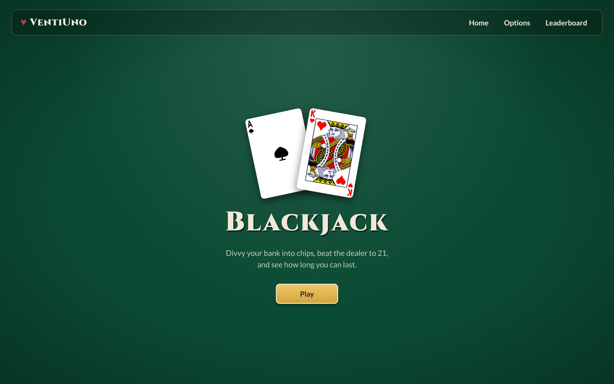
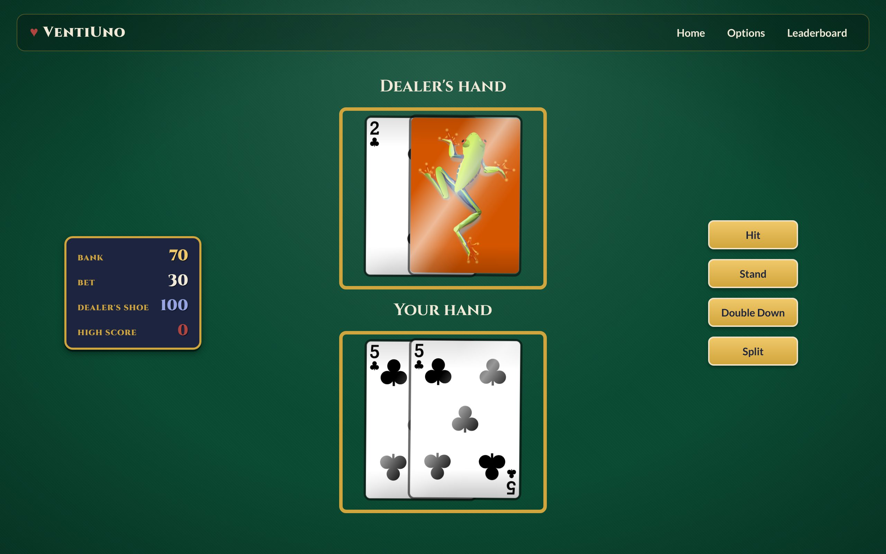
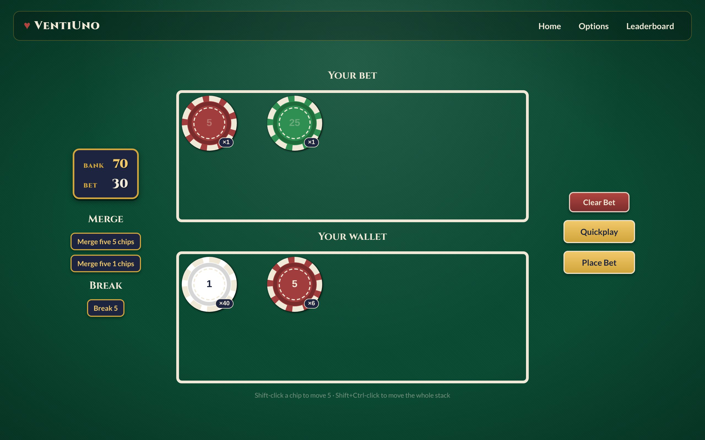
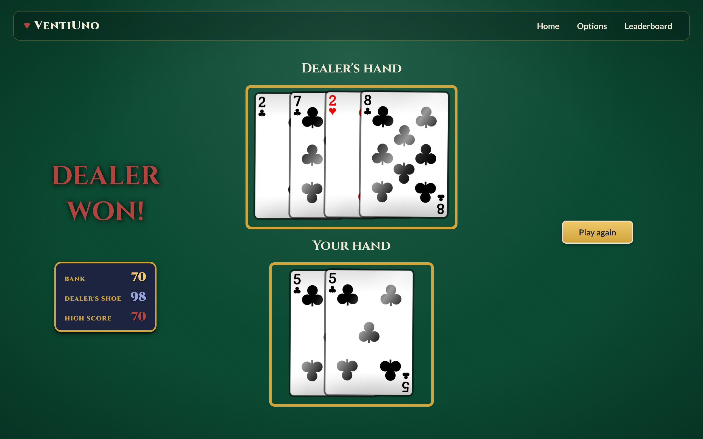
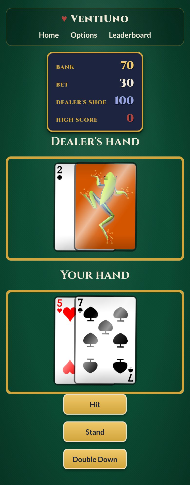

# ❤️ VentiUno

A Blackjack web app built with Django and htmx. There are no accounts and no login: open it and play. Game state lives in your browser session, so nothing about you is stored.

<p align="center">
  
  
</p>
<p align="center">
  
  
</p>

## ♠️ Features
- **Chip-based betting.** Split your starting bank into poker chips, then click or drag chips into the bet. You can merge or break chips to make change.
- **Full table rules.** Hit, stand, double down, split, and insurance. Blackjack pays 3:2.
- **htmx-driven table.** Every action swaps the table in place, so it feels like a single-page app without a JavaScript framework.
- **Deck styles.** Pick from 12 card-back designs (red, frog, fish, astronaut, and more) on the Options page.
- **Leaderboard.** Go broke with a top-10 score and you can add your name to the global leaderboard.
- **Mobile layout.** The table collapses to a single column on phones.

<p align="center">
  
</p>

## 🛠️ Built with
Python · Django 4.2 · SQLite · htmx · Animate.css · HTML/CSS/JavaScript

Game logic (`blackjack/logics/`) is kept separate from the views and is covered by unit tests, alongside view tests for the full play flow:

```shell
uv run manage.py test
```

## ♦️ Installation & Use
This project uses [uv](https://docs.astral.sh/uv/) to manage the virtual environment and dependencies.

1. Clone the repository.
   ```shell
   git clone git@github.com:ollycodes/VentiUno.git
   cd VentiUno
   ```

2. Install dependencies (creates `.venv` automatically).
   ```shell
   uv venv
   uv pip install -r requirements.txt
   ```

3. Set up your local environment. Copy `.env.example` to `.env` and fill in a real secret key:
   ```shell
   cp .env.example .env
   python -c "from django.core.management.utils import get_random_secret_key; print(get_random_secret_key())"
   ```
   Paste the generated value in as `SECRET_KEY` in `.env`. `.env` is loaded automatically and is gitignored, so it's safe to keep secrets there.

4. Migrate and run.
   ```shell
   uv run manage.py migrate
   uv run manage.py runserver
   ```
   Open in browser: http://127.0.0.1:8000/

5. (Optional) To use the Django admin at `/admin/` — e.g. to moderate leaderboard entries — create a superuser:
   ```shell
   uv run manage.py createsuperuser
   ```

## 📓 Retrospective

I built VentiUno to test my Python skills and see how they translated to web development, which led me to Django. Django was a great framework to learn on: the documentation is detailed, well structured, and intuitive. What I struggled with, I realize now, is that I was using Django with the mindset of a JavaScript developer.

I started with some game logic and a rough idea of how Django's model-view-template structure could handle game actions, but I didn't want every action to reload the page. That pointed me toward single-page apps, and I read everything I could find about them, but most of it didn't fit how Django is meant to work. I settled on server-rendered template partials, with htmx swapping in each game action. I experimented with Animate.css for a while, but ended up relying mostly on my own CSS.

If I built it again, I'd use React for the game itself. Blackjack's state changes on every click, and in VentiUno that meant a server round trip and a session write for every hit and stand, plus values threaded through layers of nested templates. Django would still be my choice for the parts that are truly server-side, like the leaderboard. It was a fantastic project to learn on, and it taught me to match the tool to the shape of the problem.

In 2026 I came back to finish it: I fixed bugs in the dealer logic and payouts, added split, double down, and insurance, wrote a test suite, and gave the UI a final polish. The project is now complete.

## ♣️ Credits
- [Playing Cards](https://tekeye.uk/playing_cards/svg-playing-cards)
